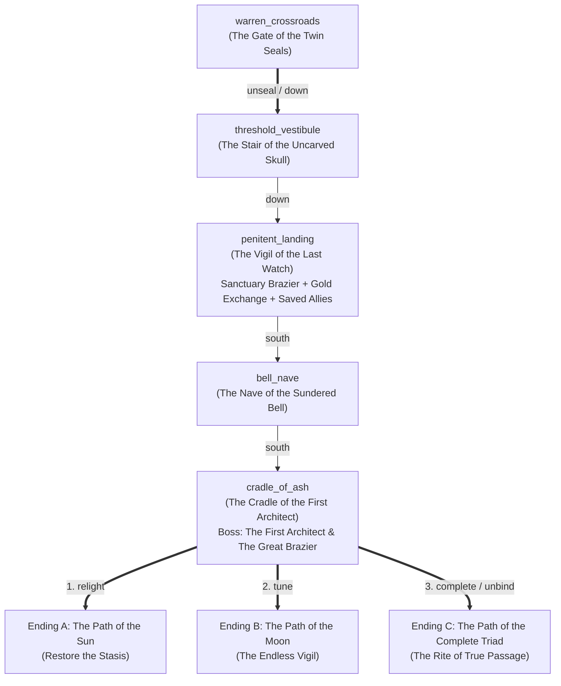

# Act III Narrative & Level Design Plan: *The Cradle of the First Architect*

> **Status:** Draft for Review (Pre-JSON Implementation)  
> **Scope:** Act III of *Barrowlight* — The descent beneath the Gate of the Twin Seals (`warren_crossroads`) into the primordial foundation of the Under-Barrow, culminating in the confrontation with **The First Architect** and the final philosophical choice at **The Great Brazier**.

---

## 1. World Geography & Progression Flow (4 Rooms)

When the player uses `unseal` on the `twin_seal_gate` in `warren_crossroads` (holding both `moon_triad_seal` and `sun_triad_seal`), instead of immediately ending the game, the twin bronze halves part and carry the player `down` into **The Cradle of the First Architect**—a four-room linear-with-sanctuary sequence descending to the bedrock heart of the barrow:

1. **Room 3A — `threshold_vestibule` (*The Stair of the Uncarved Skull*):**
   - Connects `up` back to `warren_crossroads` and `down` to `penitent_landing`.
   - The ancient builders' gallery where the original Triad of Passage was first chiseled—and where the Third Seal (the Skull) was deliberately defaced three centuries ago.
2. **Room 3B — `penitent_landing` (*The Vigil of the Last Watch* — Final Staging Sanctuary):**
   - Connects `up` to `threshold_vestibule` and `south` to `bell_nave`.
   - The final sanctuary before the point of no return: houses a **Wayfarer Sanctuary Brazier** (`verb: "rest"`), a **Reliquary Alms-Peddler / Wayfarer Quartermaster** (`startShop` or coin-blessing exchange to spend remaining gold on high-tier consumables/gear), and reactive appearances/blessings from the allies the player saved across Acts I–II (`wren_joins_descent`, `vaelen_reconciled`, `silas_relieved`).
3. **Room 3C — `bell_nave` (*The Nave of the Sundered Bell*):**
   - Connects `north` to `penitent_landing` and `south` to `cradle_of_ash`.
   - The colossal subterranean foundry-cathedral where the **Great Vesper Bell** hangs cracked in chains above a dry conduit of memory-salt and ash—revealing *why* the Barrowlight went dark at the turn of the season.
4. **Room 3D — `cradle_of_ash` (*The Cradle of the First Architect* — Final Boss & Endgame Choice):**
   - Connects `north` to `bell_nave`.
   - The primordial rotunda housing **The Great Brazier** and **The First Architect, Aurelius the Undying** (`first_architect`). Like Acts I and II, combat does **not** auto-start on entry; the player can inspect the Great Brazier and `shine` the `barrowlight` on the final Memory Echo before using `approach` to confront the First Architect. Once the encounter is resolved (`architect_resolved`), the player interacts with **The Great Brazier** to choose one of the three endings.

---

## 2. Room-by-Room Breakdown

### Room 3A: `threshold_vestibule` — *The Stair of the Uncarved Skull*
- **Atmosphere:** Below the bronze floor-gate of the Crossroads, a cyclopean stair of black basalt spirals into the earth. Unlike the rough masonry of the Upper Threshold or the whitewashed stone of the Reliquary, these walls were vitrified by ancient heat. Every twelve steps, a bronze bas-relief depicts the **Triad of Passage**—Sun, Moon, and Skull—except that on every single panel, the Skull has been chiseled out and plugged with cold lead.
- **Exits:** `up` to `warren_crossroads`, `down` to `penitent_landing`.
- **Features & Mechanics:**
  - `defaced_triad_frieze` (*defaced Triad relief*):
    - `read`: Reads the original pre-Order inscription beneath the lead plugs: *"To wake in light, to grieve in shadow, to yield in peace—none is whole without the third."*
    - `study` (`[History DC 13]`, `once: true`, automatic advantage for `vesper_cantor` / `ash_deserter` / `read_stair_relief`): Uncovers the architectural heresy at the heart of the Under-Barrow: the First Architect did not build the Great Brazier to guide the dead through the Triad, but severed the Third Pillar (the Skull) so that no soul in Greywater could ever truly die (`sets flag: read_architect_frieze`, `+30 XP`).
  - `vestibule_memory_echo` (*hidden when lacking `barrowlight`*):
    - `shine` (`once: true`): Reveals the First Architect, Aurelius, three hundred years ago, standing on the newly carved stair with a mason's hammer in his hand, weeping over the body of his young wife, **Caelia**: *"If the Skull is the law of the world, then the world is a butcher's ledger. Brick up the third gate. Let them sleep in the Sun's amber forever until I find a way to bring her back without losing a single word."* (`sets flag: shone_vestibule_echo`, `+30 XP`).

---

### Room 3B: `penitent_landing` — *The Vigil of the Last Watch* (Final Staging Sanctuary)
- **Atmosphere:** A broad circular terrace jutting over the subterranean abyss, sheltered beneath the ribs of an ancient stone aqueduct. At its center burns a low, steady **Sanctuary Brazier** ringed with worn sitting-stones. Just beyond the terrace rail, the black stone bridge narrows toward the Nave of the Sundered Bell, where the air thrums with deep, sub-audible pressure.
- **Exits:** `up` to `threshold_vestibule`, `south` to `bell_nave`.
- **Features & Mechanics:**
  - `last_watch_brazier` (*Sanctuary Brazier of the Last Watch*):
    - `rest`: Restores full HP and mana (`{ "type": "rest" }`, `sets flag: rested_at_cradle`).
  - `reliquary_quartermaster` / **The Blind Coiner's Niche** (`startShop: cradle_reliquary_shop` orNPC **Barrow-wright Oakhaven**):
    - Provides a dedicated way to spend all remaining gold before the final battle (`shops.json` entry `cradle_quartermaster`, opened via dialogue or feature interaction `barter`):
      - **Stock:** `healing_potion` (40g), `tallow_draught` (35g), `lye_salve` (55g), `holy_water` (25g), `grave_salt_bomb` (35g), and high-tier endgame gear for players with surplus coin: `architect_scale_mail` (`baseAc: 15`, `maxDexBonus: 0`, 90g) or `triad_ward_mantle` (`baseAc: 13`, `maxDexBonus: null`, 80g).
      - Also includes an **Offering Bowl of the Threshold** (`feature: threshold_alms_bowl`, `verb: "tithe"`, `once: true`) for players with small spare coin (15 gold) who wish to make a funerary offering for `+1 lantern_resonance` and a `tallow_draught`.
- **Reactive Ally Appearances & Blessings (Acts I–II Payoff):**
  - **Sister Wren (`conditions: [{ "type": "flag", "flag": "wren_joins_descent" }]`):**
    - Stands beside the brazier tending her unlit lantern (`dialogue: wren_cradle`). She shares her awe and sorrow at reaching the bottom of her Order's three-hundred-year lie, and anoints the player's brow with consecrated ash (`once: true` blessing `wren_cradle_blessing`: grants `holy_water`, `lye_salve`, `+25 XP`, and unlocks a dedicated parley option against the First Architect).
  - **Prelate Vaelen's Echo-Cairn / Messenger (`conditions: [{ "type": "flag", "flag": "vaelen_reconciled" }]`):**
    - A silver resonance-chime left by Prelate Vaelen at the head of the stair (`feature: vaelen_parting_chime`, `verb: "listen"`, `once: true`): carries Vaelen's recorded testimony—*"Tell Aurelius that a mother let her daughter finish the song. Tell him the silence after the last note was not empty."* (`sets flag: carries_vaelen_testimony`, heals `2d4+2`, grants `tallow_draught`, and grants advantage/unlocks parley with the First Architect).
  - **Commander Silas's Chalked Dispatch (`conditions: [{ "type": "flag", "flag": "silas_relieved" }]`):**
    - An iron dispatch-tablet laid beside the brazier by Commander Silas (`feature: silas_parting_tablet`, `verb: "read"`, `once: true`): bears the un-scoured signatures of his surviving soldiers and his brother Tomas's name—*"Tell the Founder that his garrison remembers why we marched, and we stand down."* (`sets flag: carries_silas_testimony`, grants `grave_salt_bomb`, and grants advantage/unlocks parley with the First Architect).

---

### Room 3C: `bell_nave` — *The Nave of the Sundered Bell*
- **Atmosphere:** A cavernous vaulted nave spanning a dry underground river of coarse white memory-salt. Suspended from the ceiling by massive bronze chains hangs **The Great Vesper Bell**—twenty feet tall, cast from green-black bronze, with a jagged vertical fracture running from its lip to its crown. Noticeably missing from its rim are two crescent-and-sun medallions (the **Twin Seals**) and a narrow three-inch sliver from its lip (the `bell_splinter` carried by the `fever_dreamer`!).
- **Exits:** `north` to `penitent_landing`, `south` to `cradle_of_ash`.
- **Features & Mechanics:**
  - `sundered_vesper_bell` (*The Great Vesper Bell*):
    - `inspect`: Reveals why the Barrowlight went out on the surface at the turn of the season: after three hundred years of holding ten thousand Greywater souls in forced stasis without release, the pressure of accumulated memory-salt cracked the Great Bell that regulates the Great Brazier.
    - `audit` / `study` (`[Arcana DC 13]` or `[Investigation DC 13]`, `once: true`, automatic advantage for `liminal_auditor` / `vesper_cantor`): Proves that relighting the Great Brazier as it was (`Sun`) or running the Choir's resonance (`Moon`) will eventually fracture the bell again unless the **Third Note (The Skull — Release)** is restored (`sets flag: diagnosed_sundered_bell`, `+30 XP`).
    - `fit` (`conditions: [{ "type": "background", "background": "fever_dreamer" }]`, `once: true`): A **Fever Dreamer** can press their `bell_splinter` into the jagged notch at the lip of the Great Vesper Bell, where it fits to the millimeter (`sets flag: fitted_bell_splinter`, `+1 lantern_resonance`, `+30 XP`).
  - `nave_memory_echo` (*hidden when lacking `barrowlight`*):
    - `shine` (`once: true`): Reveals the night the Barrowlight died at the turn of the season—the First Architect standing beneath the cracking bell, binding his own calcifying ribs with iron bands as the bronze split: *"Three hundred years, and still Caelia's face blurs when the flame dips! Hold together, damn you! If the stasis breaks, she will remember that she is dead!"* (`sets flag: shone_nave_echo`, `+30 XP`).

---

### Room 3D: `cradle_of_ash` — *The Cradle of the First Architect* (Boss & Finale Room)
- **Atmosphere:** The bedrock heart of the Under-Barrow. At the center of a vast circular amphitheater of black glass and salt-white ash stands **The Great Brazier**—an octagonal furnace-altar fed by roots of petrified bone-tallow that reach all the way up to the Lichgate on Greywater moor. Beside the cold brazier rests an alabaster sarcophagus sealed in amber glass, inside which lies the preserved, dreamless form of **Caelia**, the Architect's wife. Standing sentinel over both is **The First Architect, Aurelius the Undying**—a towering figure half-fused with bronze astrolabes, silver choir-wires, and whitewashed iron plate.
- **Exits:** `north` to `bell_nave`.

---

## 3. The Final Adversary: The First Architect (`first_architect`)

### Lore & Existential Loop
Three centuries ago, **Aurelius, the First Architect**, lost his wife **Caelia** to the winter fever on Greywater moor. Refusing to surrender her to the Third Pillar of the Triad (the Skull — finality), he designed the **Barrowlight network**. By suspending every soul buried in Greywater inside an interconnected web of dreamless stasis, he used the collective spiritual weight of the entire valley as an anchor to keep Caelia's soul suspended on the threshold—neither alive nor truly gone.
- The **Ashen Order** grew from his outer wardens, charged with keeping the dead asleep (`Sun` without `Moon` or `Skull`).
- The **Hollow Choir** grew from his inner artificers, who tried to wake the trapped voices inside the stasis (`Moon` without `Sun` or `Skull`).
- Aurelius himself has calcified across three centuries into the ultimate embodiment of both errors: he has scoured away his own mortal warmth with iron (`Sun`) while tethering himself and ten thousand strangers to a single unkept grief (`Moon`). Worse still, because he never allowed Caelia's spirit to speak or wake lest she fade, he has forgotten the sound of her voice—and never heard that Caelia herself left a parting inscription inside her sarcophagus asking to be let go.

### Pre-Boss Exploration in `cradle_of_ash`
Before using `approach` on `great_brazier`, the player can examine the room:
- `caelia_sarcophagus` (*amber-sealed sarcophagus*):
  - `inspect`: Describes the frost-etched glass over Caelia's quiet hands.
  - `read` (`[Perception DC 13]` or `[Investigation DC 13]`, `once: true`, automatic advantage for `liminal_auditor` / `fever_dreamer`): Scratched onto the *inside* of the amber glass by Caelia's fingernail before the stasis took her is the third line of the Triad litany: *"Aurelius—last the face all faces yield. Do not build a prison out of my name."* (`sets flag: read_caelia_inscription`, `+30 XP`).
- `cradle_memory_echo` (*hidden when lacking `barrowlight`*):
  - `shine` (`once: true`): Reveals the day the Great Brazier was first lit—Caelia's spirit trying to reach Aurelius through the rising amber wall, pleading with him: *"My love, a song that cannot end is only noise. Let me sleep so that you can live."*—while Aurelius, deafened by the roar of the Great Bell, turned the key (`sets flag: shone_cradle_echo`, `+30 XP`).
- `great_brazier` (*The Great Brazier of the Under-Barrow*):
  - While `notFlag: architect_resolved`:
    - `approach`: Steps onto the octagonal dais to confront the First Architect (`sets flag: challenged_architect`, `startCombat: cradle_architect_boss`).

### Boss Encounter: `cradle_architect_boss`
- **Enemies:**
  - `first_architect` (*The First Architect, Aurelius* — Boss, `5d8+6` HP, AC 14, attacks with *Pendulum of Stasis* [slashing/radiant] and *Chord of Calcification* [necrotic/psychic with `grave_chill` save], vulnerable to `force`, resistant to `necrotic`).
  - `calcified_warden` (*Calcified Threshold Warden* — Add, `2d8+2` HP, AC 12, bludgeoning/radiant).
  - *(Note: Exact HP/AC/attack weights will be tuned against `BossFightSimulator` during implementation so all 4 Callings at Level 3–4 sit squarely in the fair balance band.)*

### Parley Options & Reactivity Matrix (`cradle_architect_boss`)

| Option Type | Condition(s) | Check & Advantage | Narrative Line & Impact |
| :--- | :--- | :--- | :--- |
| **1. Core Parley (The Uncarved Third)** | Always available | `persuasion` DC 15 **`advantageIf`:** Any of `shone_cradle_echo`, `shone_nave_echo`, `shone_vestibule_echo`, `read_caelia_inscription`, `read_architect_frieze`, `diagnosed_sundered_bell`, `carries_vaelen_testimony`, or `carries_silas_testimony` | *"Speak Caelia's scratched words and the third line of the Triad: a love that refuses finality turns the beloved into a cage."* |
| **2. Calling: Oath-Eater** | `class: oath_eater` | `persuasion` DC 12 (`advantage: true`) | *"Show him the tribunal ash on your tongue: an oath that enslaves ten thousand graves to keep one promise has already devoured the thing it swore to save."* |
| **3. Calling: Liminal Auditor** | `class: liminal_auditor` | `investigation` DC 12 (`advantage: true`) | *"Audit the three-hundred-year ledger of Greywater: Caelia released him from his debt on the inside of her own glass. The contract is closed."* |
| **4. Calling: Vesper Cantor** | `class: vesper_cantor` | `performance` DC 12 (`advantage: true`) | *"Strike the Third Harmonic—the resolving chord of the Skull that allows a three-hundred-year dissonance to finally cadence into peace."* |
| **5. Calling: Remnant Vessel** | `class: remnant_vessel` | `insight` DC 12 (`advantage: true`) | *"Open the cold ember in your ribs so Aurelius feels what his broken stasis actually did to the dead who woke between the worlds."* |
| **6. Burden: Bereaved Kin** | `background: bereaved_kin` | `insight` DC 12 (`advantage: true`) | *"Hold up the tarnished locket: tell him you walked into the barrow for someone you lost too—and learned that letting them rest is the last act of love left to us."* |
| **7. Burden: Ash Deserter** | `background: ash_deserter` | `religion` DC 12 (`advantage: true`) | *"Hold up your scored signet and recite the full, unexpurgated Rite of Rest that his own Order tried to chisel out of the stone."* |
| **8. Burden: Moor Bailiff** | `background: moor_bailiff` | `persuasion` DC 12 (`advantage: true`) | *"Serve the Elders' Writ of Hollin's Rest upon the Founder himself: the living village above will no longer pay the interest on his grief."* |
| **9. Burden: Fever Dreamer** | `background: fever_dreamer` | `perception` DC 12 (`advantage: true`) | *"Hold up the bell splinter that called you through the moor's fever-dreams: the Great Bell cracked because Caelia herself was trying to ring the hour of release."* |
| **10. Acts I–II Unified Witness** | `all`: `wren_joins_descent`, `vaelen_reconciled`, `silas_relieved` | `religion` DC 10 (`advantage: true`) | *"Speak with the combined testimony of Sister Wren, Prelate Vaelen, and Commander Silas: both the Sun and the Moon have laid down their arms."* |

- **Encounter Outcomes:**
  - **Parley Success (`architect_reconciled`):** Aurelius drops his bronze pendulum, places a trembling, calcified hand against the inside inscription of Caelia's glass, and finally speaks the third line of the litany aloud: *"Last the face all faces yield."* As Caelia's amber stasis dissolves into warm golden light, Aurelius kneels beside the Great Brazier, yielding the final decision over the Under-Barrow's fate to the player (`sets flag: architect_reconciled`, `sets flag: architect_resolved`, `+1 lantern_resonance`, `+20 lantern_bearers` rep, `+200 XP`).
  - **Combat Victory (`architect_destroyed`):** Aurelius is shattered in a storm of bronze gears and cold ash; as his armor collapses beside Caelia's cracked glass, the Great Brazier stands unguarded before the player (`sets flag: architect_destroyed`, `sets flag: architect_resolved`, `-1 lantern_resonance`).

---

## 4. The Final Philosophical Choice (Post-Boss Resolution at `great_brazier`)

Once `architect_resolved` is set (whether via Parley or Combat), interacting with `great_brazier` in `cradle_of_ash` presents the three culminating endings of *Barrowlight*. Each interaction sets a distinct ending flag (`ending_sun_stasis`, `ending_moon_vigil`, or `ending_triad_passage`), advances the final quest `cradle_of_ash_quest` to `100`, and triggers `{ "type": "endGame" }`, which selects the corresponding rich epilogue in `Data/game.json`:

### Choice 1: The Path of the Sun — *Restore the Stasis* (`verb: "relight"`)
- **Label:** `"Relight the Great Brazier with the Sun Seal to force the dead back into dreamless stasis"`
- **Availability:** Always available once `architect_resolved` is set.
- **Philosophical Meaning (*Corrupted Sun — Order via Erasure*):** You lock the `sun_triad_seal` into the Great Brazier's primary grate and flood the roots of the barrow with blinding, dreamless white fire. Across Nocturne, the Weeping Stair, and Hollin's Rest, every awakened spirit—angry wraith and lucid citizen alike—is pulled back into silent, dreamless suspension.
- **Mechanical Effects:**
  - Sets `ending_sun_stasis`, `+20 ashen_order` rep, `-20 hollow_choir` rep, sets quest stage `100`, triggers `endGame`.
- **Epilogue Variations (`game.json`):** Reflects whether you reached this choice with mercy (`architect_reconciled`, `silas_relieved`, `wren_joins_descent`—reforming the Order into a gentler guardianship) or through ruthless iron (`architect_destroyed`, `silas_destroyed`—becoming the new unburdened warden of a silent tomb).

### Choice 2: The Path of the Moon — *The Endless Vigil* (`verb: "tune"`)
- **Label:** `"Tune the Great Brazier with the Moon Seal to preserve the waking spirits of the Under-Barrow forever"`
- **Availability:** Always available once `architect_resolved` is set.
- **Philosophical Meaning (*Corrupted Moon — Refusal of Loss*):** You set the `moon_triad_seal` into the Great Brazier's acoustic resonator, turning the Barrowlight network into an eternal silver amplifier. No spirit in the Under-Barrow will ever fade into the dark again; Nocturne's lanterns burn silver-blue, and the dead remain awake beside the living—even though memory-salt will continue to precipitate at the edges of every mind that stays too long.
- **Mechanical Effects:**
  - Sets `ending_moon_vigil`, `+20 hollow_choir` rep, `-20 ashen_order` rep, sets quest stage `100`, triggers `endGame`.
- **Epilogue Variations (`game.json`):** Reflects whether the Choir was tempered by Vaelen's reconciliation and Nocturne's restored beacon (`vaelen_reconciled`, `beacon_restored`), or left in obsessive, salt-choked repetition (`vaelen_destroyed`).

### Choice 3: The Path of the Complete Triad — *The Rite of True Passage* (`verb: "complete"`)
- **Label:** `"Unite Sun, Moon, and Barrowlight to restore the Rite of True Passage"`
- **Availability Condition (`any`):**
  - High empathy across the journey: `{ "type": "counter", "counter": "lantern_resonance", "min": 3 }`, **OR**
  - Uncovered the core truths of the Cradle: `{ "type": "all", "conditions": [{ "type": "flag", "flag": "read_architect_frieze" }, { "type": "flag", "flag": "diagnosed_sundered_bell" }, { "type": "flag", "flag": "read_caelia_inscription" }] }`, **OR**
  - Reconciled the First Architect in parley: `{ "type": "flag", "flag": "architect_reconciled" }`.
- **Philosophical Meaning (*The Triad Restored — Witness & Release*):** You set the `sun_triad_seal` on the left, the `moon_triad_seal` on the right, and place the `barrowlight` lantern itself into the central socket of the **Skull**. Instead of a cage of dreamless sleep or a loop of silver wire, the Great Brazier becomes a **Threshold of True Passage**:
  - Calcified spirits trapped in agony (from the upper tombs to Caelia herself) are finally released into genuine peace.
  - Lucid spirits in Nocturne who still have words left to speak are free to live, remember, and walk the Lantern Market until the day they choose, of their own will, to step into the warm gold light and rest.
  - Above on Greywater moor, the graves of Hollin's Rest stay quiet—not because the dead are chained, but because they are heard and at peace.
- **Mechanical Effects:**
  - Sets `ending_triad_passage`, `+25 lantern_bearers` rep, sets quest stage `100`, triggers `endGame`.
- **Epilogue Variations (`game.json`):** Rich, multi-paragraph endings reflecting `architect_reconciled`, `wren_joins_descent`, `vaelen_reconciled`, `silas_relieved`, `beacon_restored`, and the player's `{player.name}` and `{player.class}`.

---

## 5. Planned Quest, Shop, Item & Bestiary Additions (For Next Step)

1. **Transition Update (`Data/Rooms/warren_crossroads.json`):**
   - `unseal` on `twin_seal_gate` sets `twin_seals` stage `100`, sets `unsealed_cradle_gate`, and uses `{ "type": "moveTo", "room": "threshold_vestibule" }` instead of `endGame`. Also adds a `down` exit to `threshold_vestibule` conditioned on `unsealed_cradle_gate`.
2. **New Quest (`Data/World/quests.json`):**
   - `cradle_of_ash_quest` (*The Cradle of the First Architect*):
     - `10`: Descended the Stair of the Uncarved Skull beneath the Gate of the Twin Seals.
     - `20`: Reached the Nave of the Sundered Bell and learned the truth of the Great Brazier's fracture.
     - `30`: Resolved the confrontation with the First Architect (`architect_resolved`); the Great Brazier awaits your judgment.
     - `100`: Chose the fate of the Great Brazier and the Under-Barrow.
3. **New Shop (`Data/World/shops.json`):**
   - `cradle_quartermaster` (*The Vigil Reliquary* — kept by Barrow-wright Oakhaven in `penitent_landing`): stocks `healing_potion`, `tallow_draught`, `lye_salve`, `holy_water`, `grave_salt_bomb`, `architect_scale_mail` (`baseAc: 15`, `maxDexBonus: 0`), and `triad_ward_mantle` (`baseAc: 13`, `maxDexBonus: null`).
4. **New Dialogue (`Data/Dialogues/`):**
   - `wren_cradle.json` (*Sister Wren at the Last Watch*) and `architect_post.json` / `oakhaven.json`.
5. **New Bestiary (`Data/Bestiary/cradle_of_ash.json`):**
   - `first_architect` (*The First Architect, Aurelius*) and `calcified_warden` (*Calcified Threshold Warden*).
