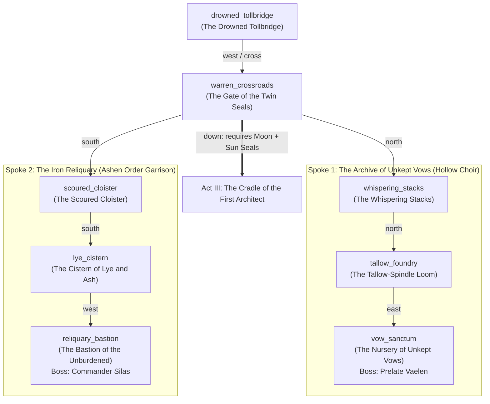

# Act II Narrative & Level Design Plan: *The Memory Warrens*

> **Status:** Draft for Review (Pre-JSON Implementation)  
> **Scope:** Act II of *Barrowlight* — The two major ideological spokes beyond the Drowned Tollbridge (`far_arch`), culminating in the recovery of the twin **Triad Seals** (**The Seal of the Waxing Moon** and **The Seal of the Unclouded Sun**) required to unseal Act III (*The Cradle of the First Architect*).

---

## 1. World Geography & Progression Flow

When the player crosses the `far_arch` at the **Drowned Tollbridge** (`drowned_tollbridge`), they enter **The Memory Warrens**—the deep civic and monastic heart of the Under-Barrow where the two rival factions hold their strongholds:

1. **Central Junction — `warren_crossroads` (The Sunken Causeway / Gate of the Twin Seals):**
   - Connects back `east` to `drowned_tollbridge`, `north` into **The Archive of Unkept Vows** (Hollow Choir Sanctum), `south` into **The Iron Reliquary** (Ashen Order Garrison), and `down` (sealed until both Triad Seals are set) toward **The Cradle of the First Architect** (Act III).
2. **Northern Spoke — The Archive of Unkept Vows (Hollow Choir Sanctum, 3 Rooms):**
   - `whispering_stacks` (*The Whispering Stacks*) -> `tallow_foundry` (*The Tallow-Spindle Loom*) -> `vow_sanctum` (*The Nursery of Unkept Vows* — Boss: **Prelate Vaelen**).
3. **Southern Spoke — The Iron Reliquary (Ashen Order Garrison, 3 Rooms):**
   - `scoured_cloister` (*The Scoured Cloister*) -> `lye_cistern` (*The Cistern of Lye and Ash*) -> `reliquary_bastion` (*The Bastion of the Unburdened* — Boss: **Commander Silas**).

> [!IMPORTANT]
> **Non-Auto-Starting Boss Pattern (from Act I):**  
> Just like `echo_chapel` and `drowned_tollbridge`, neither **Prelate Vaelen** (`vow_sanctum`) nor **Commander Silas** (`reliquary_bastion`) triggers combat immediately upon entering the room. Both bosses are engaged via an explicit `approach` interaction on their central feature (`challenged_vaelen` / `challenged_silas`), giving the player space to examine the room and `shine` the **Barrowlight** on Memory Echoes first.

---

## 2. Spoke 1: The Archive of Unkept Vows (Hollow Choir Sanctum)

### How the Hollow Choir Physically Tethers Fading Spirits
In the Under-Barrow, a spirit who refuses to pass eventually thins into mist unless anchored to a physical medium. The **Hollow Choir** (*Corrupted Moon — Pathological Clinging*) has industrialized grief into an acoustic and archival craft called **Spindle-Binding**:
1. **Memory-Tallow Cylinders & Music Boxes:** Choir artificers render pale cave-spores and funeral wax into grooved cylinders. When a dying or fading spirit speaks a memory, a bronze stylus cuts the vibration of their voice directly into the cooling wax.
2. **Silver Resonance-Thread (Grave-Wire):** Fine silver filaments are threaded through a spirit's residual ash and soldered to the brass comb of a music box or the spine of a vellum ledger.
3. **The Cruel Cost (Calcification Loop):** As long as the spring is wound or the ledger is read aloud, the spirit cannot dissolve into final death. However, because a wax cylinder or music-box comb can only hold a few bars of sound, the spirit is **forced to re-live that single snippet of memory forever**. Every replay strips away the rest of their identity, precipitating coarse white **memory-salt** until only a calcified loop of agony remains.

---

### Room-by-Room Breakdown (Archive of Unkept Vows)

#### Room 1A: `whispering_stacks` — *The Whispering Stacks*
- **Atmosphere:** Towering stone shelves carved into the cavern walls hold thousands of wax-sealed ledgers and ticking brass cylinders. Silver threads stretch from the book-spines to pale, translucent hands that turn the same page forward and back in endless silence. The air smells of warm beeswax, ozone, and dry vellum.
- **Exits:** `south` to `warren_crossroads` (or `drowned_tollbridge`), `north` to `tallow_foundry`.
- **Features & Mechanics:**
  - `bound_ledgers` (*shelves of tethered ledgers*):
    - `read`: Reads a ledger of unkept promises from Hollin's Rest.
    - `audit` (`[Investigation DC 12]`, `once: true`, automatic advantage for `liminal_auditor` / `moor_bailiff`): Discovers the Choir's **Index of Severance**, revealing that Prelate Vaelen's own daughter, **Lira**, is bound to a silver nursery-carillon in the inner sanctum (`sets flag: read_vaelen_ledger`, `+25 XP`).
  - `stacks_memory_echo` (*hidden when lacking `barrowlight`*):
    - `shine` (`once: true`): Reveals a memory of Prelate Vaelen arguing with a Choir archivist who begged her to stop re-cutting her daughter's wax cylinder: *"Every time you deepen the groove so she won't fade, Prelate, you shave away another year of her life! Soon she won't remember your face—only the fever!"* (`sets flag: shone_stacks_echo`, `+25 XP`).
- **NPC:** **Archivist Caelan** (`dialogue: caelan`) — A blind mortal scribe whose fingers are raw from winding thousands of brass keys every day. He is terrified of stopping because his dead wife's voice is in one of the cylinders, though he can no longer tell which one.

#### Room 1B: `tallow_foundry` — *The Tallow-Spindle Loom*
- **Atmosphere:** The workshop where the Choir renders spore-wax and draws silver wire. Copper vats simmer over low blue lamps, and a water-driven loom winds hair-thin silver thread onto brass bobbins. White memory-salt cakes the drainage grates like frozen snow.
- **Exits:** `south` to `whispering_stacks`, `east` to `vow_sanctum`.
- **Features & Mechanics:**
  - `spindle_loom` (*silver-wire loom*):
    - `sabotage` (`[Sleight of Hand DC 12]` or `[Arcana DC 12]`, `once: true`): Unhooks the master tension-weight, slackening the Choir's resonance wires across the sanctum (`sets flag: slackened_choir_loom`, `+1 lantern_resonance`, `-10 hollow_choir` rep, `+5 lantern_bearers` rep, and weakens the Choir's hold in the sanctum).
    - `tune` (`[Performance DC 12]`, `once: true`): Aligns the acousticcones to ease the friction on the bound spirits without snapping their threads (`sets flag: tuned_choir_loom`, `+10 hollow_choir` rep, grants item `spindle_ward_charm`).
  - `foundry_memory_echo` (*hidden when lacking `barrowlight`*):
    - `shine` (`once: true`): Shows little Lira's first day in the Under-Barrow—still lucid then, asking her mother why the silver wire around her wrist pulls whenever she tries to close her eyes: *"Mama, I know the song by heart now. Why won't the box let me finish the last verse?"* (`sets flag: shone_foundry_echo`, `+25 XP`).
  - `cooling_vat` (*vat of refined memory-tallow*):
    - `search` / `draw` (`once: true`): Grants `tallow_draught`.

#### Room 1C: `vow_sanctum` — *The Nursery of Unkept Vows* (Boss Room)
- **Atmosphere:** A domed subterranean rotunda hung with ratusan silver plumb-lines that converge on a single gilded cradle-reliquary at the center: **The Carillon of Lira**. Inside the glass-and-silver music box, the small, salt-crusted spirit of a seven-year-old girl is forced to turn on a brass gear, singing the first four bars of a winter lullaby before the pin catches and wrenches her back to the first note.
- **Boss Adversary:** **Prelate Vaelen of the Hollow Choir** (`prelate_vaelen`, accompanied by a `tethered_chorister`).
  - **Existential Loop:** Vaelen promised her dying daughter on the surface: *"I will never let the dark take you."* Unable to accept mortality (the Skull), Vaelen founded the Choir's spindle-rite and bound Lira's spirit to the gilded carillon, embedding the **Seal of the Waxing Moon** (`moon_triad_seal`) into its mainspring to power it forever. Vaelen refuses to hear that Lira's voice has degraded into a scraping, agonizing click of salt and wire.
- **Features & Mechanics:**
  - `lira_carillon` (*gilded carillon-cradle*):
    - `approach`: Engages Prelate Vaelen (`sets flag: challenged_vaelen`, `startCombat: archive_vaelen_boss`).
    - `take` (after `vaelen_resolved`): Claims the **Seal of the Waxing Moon** (`moon_triad_seal`).
  - `sanctum_memory_echo` (*hidden when lacking `barrowlight`*):
    - `shine` (`once: true`): Reveals the night Lira actually died in Hollin's Rest—Lira wasn't afraid of the dark; she only asked her mother to finish the lullaby's final line (*"Sleep until the morning field"*), the very line Vaelen cut off the wax cylinder so the song would never end (`sets flag: shone_sanctum_echo`, `+25 XP`).
- **Encounter (`archive_vaelen_boss`) & Parley Options:**
  - **Standard Parley (`[Persuasion DC 14]`):** *"Sing the final line of Lira's lullaby so the cylinder can reach its end."*
    - **Advantage (`advantageIf`):** Any of `shone_sanctum_echo`, `shone_foundry_echo`, `shone_stacks_echo`, or `read_vaelen_ledger`.
  - **Calling / Burden Parley Hooks (see Section 4 for full matrix):**
    - `vesper_cantor` (`[Performance DC 12]`, advantage): Harmonize with the carillon's comb to play the missing cadence of release.
    - `liminal_auditor` (`[Persuasion DC 12]`, advantage): Cite the *Clause of Fulfilled Custody*—proving a mother's vow to protect her child is fulfilled by ending her pain, not prolonging it.
    - `remnant_vessel` (`[Insight DC 12]`, advantage): Speak for Lira's salt-choked spirit from the threshold of your own half-dead chest.
    - `bereaved_kin` (`[Insight DC 11]`, advantage): Hold up the `tarnished_locket` and confess what clinging did to your own heart.
  - **Outcomes:**
    - **Parley Success (`vaelen_reconciled`):** Vaelen breaks down, takes the silver winding-key from the carillon, and whispers the final line of the lullaby herself. Lira's salt-crust dissolves into warm golden motes as she touches her mother's cheek and rests at last (`+1 lantern_resonance`, `+15 lantern_bearers` rep, `-10 hollow_choir` rep, `+160 XP`). Vaelen remains as a non-hostile NPC (`dialogue: vaelen`).
    - **Combat Victory (`vaelen_destroyed`):** Vaelen falls beside the shattered carillon; the mainspring snaps with a shriek of torn wire (`-1 lantern_resonance`, `-20 hollow_choir` rep).

---

## 3. Spoke 2: The Iron Reliquary (Ashen Order Garrison)

### How the Ashen Soldiers Scrub Their Own Memories
Where the Hollow Choir drowns in pathological memory, the **Iron Reliquary** represents the opposite extreme: **Corrupted Sun — Order via Self-Erasure**. Cut off from the surface and terrified that grief, doubt, or pity for the waking dead will cause them to desert (like Sister Wren) or calcify in guilt (like Toll-Warden Garin), **Commander Silas** instituted **The Rite of the Scoured Brow**:
1. **Lye-Ash Baptism:** Soldiers kneel before a cistern of caustic grey lye boiled from cremated bone-ash and iron filings, scrubbing their brows and tongues until taste and smell vanish.
2. **The Brand of the Unburdened:** Each soldier writes their personal memories—the names of their mothers, wives, villages, and fallen comrades—onto strips of lead foil, then melts the lead into an iron furnace powered by **The Seal of the Unclouded Sun** (`sun_triad_seal`).
3. **The Cruel Cost (Living Calcification):** By burning away every personal attachment so they feel neither fear nor sorrow in battle, the soldiers have inflicted **living calcification** upon themselves. They do not know their own names, why they descended into the barrow, or that the Ashen Order on the surface has already collapsed. They march in silent, terrifyingly disciplined formations, executing an obsolete purge order forever.

---

### Room-by-Room Breakdown (The Iron Reliquary)

#### Room 2A: `scoured_cloister` — *The Scoured Cloister*
- **Atmosphere:** A stark, whitewashed subterranean barracks smelling sharply of boiled lye, wet iron, and scorched lead. Along the walls, hundreds of identical iron helms hang above bunk-alcoves that contain no personal effects—every portrait, letter, and keepsake has been chiseled or burned away.
- **Exits:** `north` to `warren_crossroads`, `south` to `lye_cistern`.
- **Features & Mechanics:**
  - `confessional_grate` (*iron confessional grate*):
    - `search` (`[Investigation DC 12]`, `once: true`): Beneath the floor-grate, the player finds an unmelted lead strip dropped by Commander Silas before his third scouring—bearing the name of his younger brother, **Novice Tomas**, whom Silas executed for refusing to burn a mourner's grave (`sets flag: found_silas_lead_strip`, `+25 XP`).
  - `cloister_memory_echo` (*hidden when lacking `barrowlight`*):
    - `shine` (`once: true`): Reveals Commander Silas kneeling at the grate months ago, weeping as he presses a hot iron to his own forearm: *"Take the boy's face out of my head. If I remember how Tomas looked at me when the pyre caught, I won't be able to give the next order."* (`sets flag: shone_cloister_echo`, `+25 XP`).
- **NPC:** **Quartermaster Venn** (`dialogue: venn`) — An aging Ashen armorer who has undergone the Rite of the Scoured Brow twice. He answers every question in polite, hollow military regulation, unable to remember what season it is or what rain feels like, yet a faint tremor in his hand betrays a phantom grief he cannot name.

#### Room 2B: `lye_cistern` — *The Cistern of Lye and Ash*
- **Atmosphere:** A vaulted stone baptistery where a cauldron-cistern of steaming grey lye-water bubbles above a furnace flue. Stone troughs run along the floor, crusted with caustic white alkali and droplets of cooled lead from melted memory-scrolls.
- **Exits:** `north` to `scoured_cloister`, `west` to `reliquary_bastion`.
- **Features & Mechanics:**
  - `caustic_cistern` (*cistern of boiling lye-ash*):
    - `quench` (`[Athletics DC 12]` or `[Religion DC 12]`, `once: true`): Diverts cold groundwater from the canal pipe into the lye-cistern, diluting the memory-scouring bath (`sets flag: quenched_lye_cistern`, `+1 lantern_resonance`, `+10 lantern_bearers` rep, `-5 ashen_order` rep).
    - `salvage` (`[Medicine DC 12]`, `once: true`): Skims purified iron-ash salve from the cooling trough, granting `holy_water` and `healing_potion`.
  - `cistern_memory_echo` (*hidden when lacking `barrowlight`*):
    - `shine` (`once: true`): Shows the garrison's final muster before the scouring—soldiers handing Commander Silas their wedding rings and family lockets to be cast into the furnace, while Silas promises them: *"An empty heart cannot break. I will carry the reason for the march; you need only carry the steel."*—shortly before Silas scoured his own mind too, leaving **no one** in the garrison who remembers the reason (`sets flag: shone_cistern_echo`, `+25 XP`).

#### Room 2C: `reliquary_bastion` — *The Bastion of the Unburdened* (Boss Room)
- **Atmosphere:** A subterranean command sanctum dominated by **The Furnace of Remission**—a towering iron brazier whose grate is set with the blazing **Seal of the Unclouded Sun** (`sun_triad_seal`). Around the dais, rows of melted lead ingots—the liquefied memories of an entire company—sit stacked like cordwood.
- **Boss Adversary:** **Commander Silas, the Unburdened** (`commander_silas`, accompanied by a `scoured_halberdier`).
  - **Existential Loop:** Silas promised his soldiers that he alone would remember why they marched so they could be free of guilt. But the memory of executing his own brother, Novice Tomas, was too unbearable; Silas secretly underwent the Rite of the Scoured Brow himself. Now he stands before the Furnace of Remission in spotless, ash-white plate, drilling a garrison of hollow men for a campaign whose objective, enemy, and homeland he has completely forgotten.
- **Features & Mechanics:**
  - `furnace_of_remission` (*Furnace of Remission*):
    - `approach`: Engages Commander Silas (`sets flag: challenged_silas`, `startCombat: reliquary_silas_boss`).
    - `take` (after `silas_resolved`): Claims the **Seal of the Unclouded Sun** (`sun_triad_seal`).
  - `bastion_memory_echo` (*hidden when lacking `barrowlight`*):
    - `shine` (`once: true`): Reveals Silas standing alone before the furnace ten minutes after his own scouring, staring at a blank dispatch table in quiet terror: *"Why is the seal in the grate? Who are we marching against? ...Stand to attention. If I do not stop barking the drill, the men will never know I have forgotten."* (`sets flag: shone_bastion_echo`, `+25 XP`).
- **Encounter (`reliquary_silas_boss`) & Parley Options:**
  - **Standard Parley (`[Persuasion DC 14]`):** *"Ask him to name a single soldier under his command, or the brother he burned his mind to forget."*
    - **Advantage (`advantageIf`):** Any of `shone_bastion_echo`, `shone_cistern_echo`, `shone_cloister_echo`, or `found_silas_lead_strip`.
  - **Calling / Burden Parley Hooks (see Section 4 for full matrix):**
    - `oath_eater` (`[Intimidation DC 12]` or `[Persuasion DC 12]`, advantage): Show him the ash-stain on your lips—the proof that surviving a broken vow hurts less than erasing your own soul.
    - `ash_deserter` (`[Religion DC 11]`, advantage): Hold up the `scored_signet` and name Novice Tomas and the Marley grave—forcing the memory back through the Order's own litany.
    - `moor_bailiff` (`[Persuasion DC 12]`, advantage): Present the `elders_writ` from Hollin's Rest as an official surface dispatch recalling the garrison and ending the campaign.
    - `wren_joins_descent` / `wren_trusts_player` (`[Religion DC 12]`, advantage): Speak Sister Wren's testimony and the true Rite of Rest—relieving the commander of a watch he can no longer remember.
  - **Outcomes:**
    - **Parley Success (`silas_relieved`):** Silas tries to recite the Order's battle-catechism, falters when he hears the name *Tomas*, and drops to one knee as thirty years of exiled grief finally break through his scoured calm. He orders the `scoured_halberdier` to stand down and unbolts the **Seal of the Unclouded Sun** from the furnace (`+1 lantern_resonance`, `+15 ashen_order` rep, `+10 lantern_bearers` rep, `+160 XP`). Silas remains as a non-hostile NPC (`dialogue: silas`).
    - **Combat Victory (`silas_destroyed`):** Silas fights with mechanical, terrifying precision until his armor gives way, dying without ever remembering his own name (`-1 lantern_resonance`, `-15 ashen_order` rep).

---

## 4. Philosophical Choices: Calling & Burden Reactivity Matrix

In Act II, the player's **Calling** (`class`) and **Burden** (`background`) are not merely numeric bonuses—they represent lived philosophical stances toward memory, duty, and death across both spokes:

### A. Reactivity by Calling (`Data/Rules/classes.json`)

| Calling | Archive of Unkept Vows (Hollow Choir) | The Iron Reliquary (Ashen Garrison) |
| :--- | :--- | :--- |
| **Oath-Eater** (`oath_eater`) | **Dialogue (`caelan`):** Recognizes that Vaelen's vow to her dying daughter has calcified into a prison. Can warn Archivist Caelan that an oath kept at the cost of the beloved's agony is already broken. **Parley (`prelate_vaelen`):** Can offer to bear the weight of breaking Vaelen's maternal vow for her (`[Persuasion DC 12]`, advantage). | **Dialogue (`venn`):** Quartermaster Venn recognizes the tribunal ash-scar on the Oath-Eater's mouth—the mark of a soldier who swallowed their failure instead of scouring it away with lye. **Parley (`commander_silas`):** Unique option (*"Show him the ash on your lips: a real soldier swallows a broken vow instead of burning out his own mind"*, `[Persuasion DC 12]`, advantage). |
| **Liminal Auditor** (`liminal_auditor`) | **Exploration (`whispering_stacks`):** Automatic advantage on `[Investigation DC 12]` when auditing the Choir's ledgers. **Parley (`prelate_vaelen`):** Unique option (*"Invoke the Clause of Fulfilled Custody: her debt of care to Lira is paid in full"*, `[Persuasion DC 12]`, advantage). | **Dialogue (`venn`):** Can inspect the garrison's blank muster-rolls and point out that an army with no recorded names has no legal chain of command. **Parley (`commander_silas`):** Can audit Silas's blank dispatch table and declare the garrison's commission void (`[Investigation DC 12]`, advantage). |
| **Vesper Cantor** (`vesper_cantor`) | **Exploration (`tallow_foundry`):** Immediately recognizes Spindle-Binding as a perversion of Vesper acoustics (forcing a closed loop instead of a decaying harmonic). **Parley (`prelate_vaelen`):** Unique option (*"Intone the final resolving cadence of Lira's lullaby on the carillon's comb"*, `[Performance DC 11]`, advantage). | **Exploration (`lye_cistern`):** Hears the dead, flat acoustics of the scoured stone where even echoes have been dampened with lead. **Dialogue (`venn`):** Hums the novice's waking-bell, briefly waking a tear on Venn's cheek before he knows why he is crying. |
| **Remnant Vessel** (`remnant_vessel`) | **Dialogue (`caelan`) & Exploration:** The tethered spirits in the stacks lean toward the cold ember in the Vessel's chest, recognizing someone who died and woke without a wire. **Parley (`prelate_vaelen`):** Unique option (*"Let Lira's spirit speak through the cold ember in your ribs so Vaelen hears what the wire feels like"*, `[Insight DC 11]`, advantage). | **Dialogue (`venn`) & Boss Intro:** The scoured soldiers register the Vessel as an anomaly—a dead thing that still chooses its own path. **Parley (`commander_silas`):** Unique option (*"Stand before him as proof that the dead do not need iron or erasure to keep their minds"*, `[Persuasion DC 12]`, advantage). |

### B. Reactivity by Burden (`Data/Rules/backgrounds.json`)

| Burden & Keepsake | Archive of Unkept Vows (Hollow Choir) | The Iron Reliquary (Ashen Garrison) |
| :--- | :--- | :--- |
| **Bereaved Kin** (`bereaved_kin` / `tarnished_locket`) | **Core Thematic Mirror (The Moon):** Prelate Vaelen is what the Bereaved Kin could become if they refuse to let their loved one rest. Showing the `tarnished_locket` to Vaelen unlocks the lowest-DC empathetic parley (`[Insight DC 11]`, advantage): *"I came to the barrow for someone I lost too. Look at what your love is doing to her."* | In dialogue with Quartermaster Venn, can refuse the temptation of the lye-cistern: *"I would rather ache for the rest of my life than forget their name."* (`+1 lantern_resonance`). |
| **Ash Deserter** (`ash_deserter` / `scored_signet`) | Archivist Caelan initially flinches at the Ashen signet until he sees the deserter's gouge across the flame, earning instant trust (`+5 hollow_choir` rep). | **Core Thematic Mirror (The Sun):** Commander Silas was the officer who enforced the very purges that drove the Ash Deserter to walk out. Showing the `scored_signet` and naming Novice Tomas unlocks a signature parley (`[Religion DC 11]`, advantage). |
| **Moor Bailiff** (`moor_bailiff` / `elders_writ`) | Can serve Archivist Caelan with the `elders_writ` regarding the stolen heirlooms and voices of Hollin's Rest, unlocking a peaceful handover of a Choir cache (`+25 gold`). | Can present the `elders_writ` to Commander Silas as an official surface warrant discharging the garrison's watch (`[Persuasion DC 11]`, advantage). |
| **Fever Dreamer** (`fever_dreamer` / `bell_splinter`) | Holding the `bell_splinter` near the Carillon of Lira causes the bronze sliver to hum in counter-phase with the **Seal of the Waxing Moon**, revealing that both seals were originally fragments of the First Architect's Great Bell (`sets flag: heard_seal_harmonic`, granting advantage on Vaelen's parley). | Holding the `bell_splinter` near the Furnace of Remission resonates with the **Seal of the Unclouded Sun**, cutting through Commander Silas's scoured stupor (`grants advantage on Silas's parley`). |

---

## 5. Planned Quest, Item & Bestiary Additions (For Next Step)

### Quest (`Data/World/quests.json`)
- **`twin_seals` (*The Twin Seals of the Warrens*):**
  - `10`: Crossed the Drowned Tollbridge to the Gate of the Twin Seals (`warren_crossroads`). The way to the Cradle of the First Architect is locked by two missing Triad Seals: the Moon Seal in the Archive of Unkept Vows (north) and the Sun Seal in the Iron Reliquary (south).
  - `20`: Recovered the first of the two Triad Seals (`moon_triad_seal` or `sun_triad_seal`).
  - `30`: Recovered both the **Seal of the Waxing Moon** and the **Seal of the Unclouded Sun**.
  - `100`: Set both Triad Seals into the Gate of the Twin Seals in `warren_crossroads`, unsealing the descent into the Cradle of the First Architect.

### New Items (`Data/Items/`)
- **Quest Items:**
  - `moon_triad_seal` (*Seal of the Waxing Moon*): A crescent disc of pale silver-bronze warm with remembered voices, recovered from the Carillon of Lira.
  - `sun_triad_seal` (*Seal of the Unclouded Sun*): A radiant disc of fire-gilded bronze recovered from the Furnace of Remission.
- **Equipment & Consumables:**
  - `spindle_ward_charm` / `choir_silks` (*Choir-Woven Vestments*, Armor, `baseAc: 12`, no DEX cap — an upgrade for unarmored/light casters like the Vesper Cantor).
  - `scoured_halberd` (*Unburdened Glaive*, Weapon, `1d10` slashing) or `silver_tuning_blade` (*Resonant Stiletto*, Weapon, `1d6+1` piercing, `finesse: true`).
  - `lye_salve` (*Alkali Clarity Draught*, Consumable, heals `2d4+4` HP).

### New Bestiary (`Data/Bestiary/memory_warrens.json`)
- `prelate_vaelen` (*Prelate Vaelen of the Hollow Choir* — Boss, `4d8+4` HP, AC 13, thunder/psychic attacks, vulnerable to `radiant` and `force`).
- `tethered_chorister` (*Tethered Chorister* — Add, `2d6+2` HP, AC 11, psychic/slashing).
- `commander_silas` (*Commander Silas, the Unburdened* — Boss, `4d8` HP, AC 14, slashing/radiant attacks, resistant to `necrotic`, vulnerable to `psychic` and `lightning`). Tuned down from `4d8+6` HP, AC 15, a `1d8+3` glaive, and slashing resistance by `MemoryWarrensBalanceTests`: as first written, a level-3 hero of any Calling won only 24–43% of solo fights.
- `scoured_halberdier` (*Scoured Halberdier* — Add, `2d6+1` HP, AC 13, slashing).
