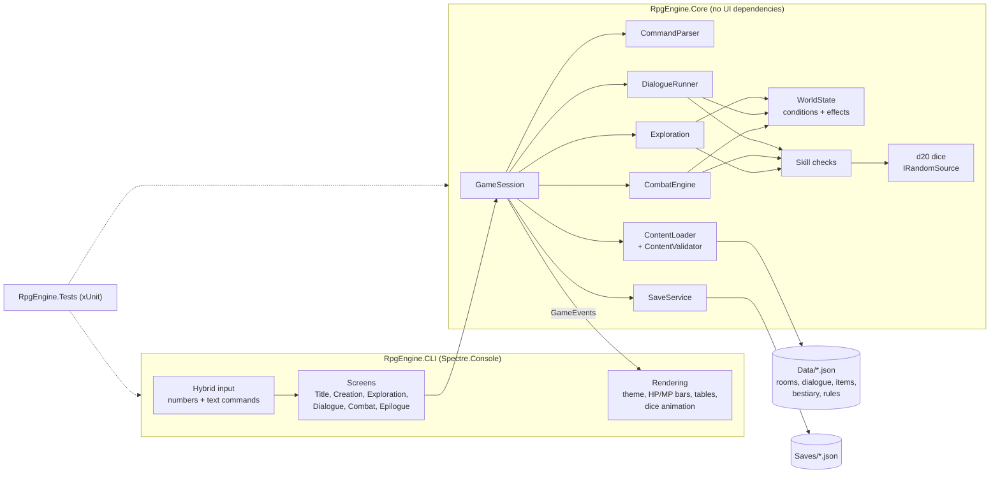

# text-rpg-engine

A narrative-driven, text-based RPG engine for the terminal, written in C# on .NET 10. It draws on tabletop d20 rules (the 5e SRD), the exploration of **Zork**, and the turn-based dungeon combat of **Wizardry** and **The Bard's Tale**.

The engine is **purely data-driven**. Every room, item, monster, line of dialogue, class, and rule constant is loaded from JSON in [`Data/`](Data/), so new adventures can be written without touching C#.

> **Status:** **Milestone 1 (the vertical slice) is complete.** *Barrowlight* is a short, playable three-room adventure with character creation, a branching NPC conversation with skill checks and permanent consequences, a riddle-and-trap puzzle, and a boss you can fight, flee, or talk down.

---

## Features

- **Exploration:** rooms connected by exits (north, up, in…), with rich sensory descriptions, inspectable features, hidden secrets, and puzzles.
- **Choices & consequences:** branching dialogue and event trees that read and write a global `WorldState` (flags, counters, faction reputation, quest stages). Choices permanently change the world.
- **d20 mechanics:** STR/DEX/CON/INT/WIS/CHA, classes, proficiency and expertise, and inventory and equipment. Narrative skill checks show inline, e.g. `[Persuasion DC 14]`, with advantage and disadvantage.
- **Tactical combat:** initiative, attacks against AC, crits, spells and techniques, status effects, resistances, and **Flee** and **Parley** options.
- **Retro terminal UI** ([Spectre.Console](https://spectreconsole.net/)):
  - color-coded narration, HP/MP bars, stat tables, and animated dice rolls
  - **hybrid input**: pick numbered options or type classic commands like `look`, `inspect altar`, `press sun`
- **Save/Load** to JSON in `Saves/`.

## The adventure: *Barrowlight*

Rain, a hilltop barrow, and a lantern that kept the dead asleep until it went dark. Pick a **Fighter**, **Rogue**, or **Wizard**:
- Win over (or drive off) Sister Wren at **the Lichgate**, and search the graves for anything left behind.
- Work out the sigil riddle on the bronze door in **the Ossuary Hall**, ideally without losing a hand to the trap.
- Face what guards **the Barrow Heart**.

What you say to Wren permanently changes the world. It decides what you learn, whether she is still there when you come back, how the final encounter can end, and which of five epilogues you get.

## Architecture



**Key principles:**
- **Core never touches the console.** It returns `GameEvent`s, and the CLI decides how to show them.
- **All randomness goes through an injectable `IRandomSource`.** That makes every roll reproducible with `--seed` and exactly testable.
- **Content is validated at startup.** Broken references, typos, and bad dice expressions are all reported at once, and the same validation runs in the test suite.

## Project structure

```
RpgEngine.slnx
Data/                   Game content (JSON): Rules/, World/, Rooms/, Dialogues/, Items/, Bestiary/, game.json
src/RpgEngine.Core/     Engine: dice, characters, checks, world state, content, combat, persistence
src/RpgEngine.CLI/      Terminal UI and game loop
tests/RpgEngine.Tests/  Unit, content-validation, and playthrough tests
.github/workflows/      CI: build and test on every push and pull request
CLAUDE.md               Contributor guide: coding standards, JSON schemas, Git workflow
```

## Getting started

**Prerequisites:** the [.NET 10 SDK](https://dotnet.microsoft.com/download/dotnet/10.0); `global.json` pins 10.0.401 or a later feature band. A modern terminal (Windows Terminal, iTerm2, any recent Linux terminal) gives the best colors and Unicode bars.

```bash
git clone https://github.com/phanto17/text-rpg-engine.git
cd text-rpg-engine
dotnet build
dotnet test
dotnet run --project src/RpgEngine.CLI
```

Useful flags (after `--`): `--seed <n>` for a reproducible run, `--no-anim` to skip dice animations, `--data <dir>` for an alternate content folder, `--saves <dir>` for an alternate save folder, `--help` for a summary. If the content in `Data/` has problems, the game lists every one of them and exits with code 1.

## How to play

**Character creation:**
- Choose a name and a class.
- Set your ability scores with the standard array (auto-assigned for your class, or assigned yourself) or by rolling 4d6 and dropping the lowest die.
- Pick your trained skills. Rogues also choose two skills for expertise.

**Exploring:** each turn shows your status line and a numbered list of actions. Type the **number** of a listed action, or a **command**:

| Command | Meaning |
|---|---|
| `look`, `l` | Describe the room again |
| `go north`, `n` `s` `e` `w` `u` `d` | Move |
| `inspect <thing>`, `x <thing>` | Examine a feature, item, or person |
| `<verb> <thing>` | Interact, e.g. `read inscription`, `press sun` |
| `take <item>` / `drop <item>` | Pick up or drop |
| `use <item> [on <thing>]`, `equip <item>` | Use or equip items |
| `talk to <npc>` | Start a conversation |
| `inventory`, `i` · `stats`, `c` · `journal`, `j` | Character info |
| `save [slot]` / `load [slot]` | Save or load (exploration only; default slot `quicksave`) |
| `help`, `?` · `quit` | Help, or return to the title screen |

**Conversations:** pick a numbered reply. Replies that need a skill check show a badge like `[Persuasion DC 14]`, plus `(advantage)` when something you learned earlier helps. Some checks can be attempted only once, so choose carefully.

**Combat:** combat is turn-based in initiative order. On your turn you can:
- **Attack**
- use **Spells and techniques** (mana or per-fight uses)
- **Use an item**
- **Defend** (+2 AC)
- **Parley** (when the foe will listen)
- **Flee** (`[Acrobatics DC 12]`)

## Writing content

Everything lives in `Data/`. To add a room, an item, or a whole dialogue tree:

1. Add JSON following the schemas in [CLAUDE.md](CLAUDE.md#content-json-reference).
2. Run `dotnet test`. Content validation reports every broken reference or typo.
3. Play it with `dotnet run --project src/RpgEngine.CLI -- --seed 1`.

## Testing

```bash
dotnet test
dotnet test --collect:"XPlat Code Coverage"
```

There are about 720 tests, all deterministic:
- **Unit tests** for every Core system. The dice and skill-check code has 100% line and branch coverage.
- **Content validation** of the shipped `Data/`, plus fixtures that prove each validator rule catches what it should.
- **Scenario tests** that play the Barrowlight storylines through the engine with scripted dice (`FixedRandomSource`).
- **CLI playthroughs** that drive the real terminal UI with scripted keyboard input through Spectre.Console's `TestConsole`.

Dice fairness is checked with fixed-seed chi-square tests.

**CI:** GitHub Actions ([`.github/workflows/ci.yml`](.github/workflows/ci.yml)) restores, builds in Release, and runs the full test suite on Ubuntu and Windows for every push and pull request to `main`. Warnings fail the build, so a red check means the same thing it would locally.

## Roadmap

- [x] **Phase 1:** solution scaffold, tooling, documentation, Git and GitHub
- [x] **Milestone 1 (vertical slice):**
  - character creation
  - a 3-room starter dungeon, *Barrowlight*: an NPC dialogue with skill checks and permanent consequences, an inspectable puzzle, and a turn-based combat encounter with flee and parley
  - save and load
  - full test coverage of dice and skill checks
- [x] **CI:** GitHub Actions build and test on Ubuntu and Windows
- [ ] **Later:** leveling and rests, multi-character parties, races and backgrounds, shops, more dungeons, JSON Schema export for editor autocomplete

## Contributing

See [CLAUDE.md](CLAUDE.md) for architecture rules, coding standards, the full JSON schema reference, and the Git workflow (Conventional Commits; commit only when the build and tests are green).
