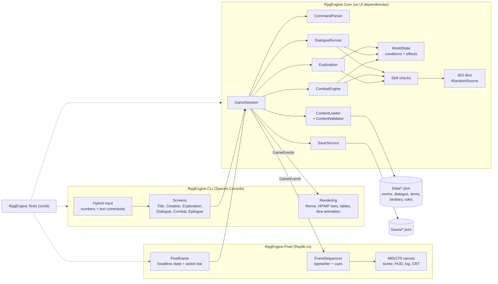

# text-rpg-engine

A narrative-driven, text-based RPG engine written in C# on .NET 10, with two front ends: a terminal client and a retro pixel-art desktop client. It draws on tabletop d20 rules (the 5e SRD), the exploration of **Zork**, and the turn-based dungeon combat of **Wizardry** and **The Bard's Tale**.

The engine is **purely data-driven**. Every room, item, monster, line of dialogue, class, and rule constant is loaded from JSON in [`Data/`](Data/), so new adventures can be written without touching C#.

> **Status:** **Version 1.0: Milestones 1 to 4 are complete.** *Barrowlight* is a complete eighteen-room adventure. A three-room prologue (character creation, a branching NPC conversation with permanent consequences, a riddle-and-trap puzzle, and a boss you can fight, flee, or talk down) leads into **Act I**, a descent to the underground lantern-town of Nocturne; **Act II**, the Memory Warrens, where two rival strongholds each guard half of the seal on the way down; and **Act III**, the Cradle of the First Architect, where the adventure ends with a choice at the Great Brazier. Milestone 2 added four Greywater **Callings**, **Burdens** (backgrounds) that the story reacts to, **leveling**, **sanctuary rests**, and **shops**. **Milestone 5** adds `RpgEngine.Pixel`, a graphical client that plays the same game and shares its saves with the terminal.

---

## Features

- **Exploration:** rooms connected by exits (north, up, in…), with rich sensory descriptions, inspectable features, hidden secrets, and puzzles.
- **Choices & consequences:** branching dialogue and event trees that read and write a global `WorldState` (flags, counters, faction reputation, quest stages). Choices permanently change the world.
- **d20 mechanics:** STR/DEX/CON/INT/WIS/CHA, Callings (classes) and Burdens (backgrounds), proficiency and expertise, and inventory and equipment. Narrative skill checks show inline, e.g. `[Persuasion DC 12]`, with advantage and disadvantage.
- **Tactical combat:** initiative, attacks against AC, crits, spells and techniques, status effects, resistances, and **Flee** and **Parley** options.
- **Progression:** XP thresholds with automatic level-ups (more HP and mana, a better proficiency bonus, and new techniques), full rests at sanctuaries, and merchants who buy and sell with limited stock.
- **Retro terminal UI** ([Spectre.Console](https://spectreconsole.net/)):
  - color-coded narration, HP/MP bars, stat tables, and animated dice rolls
  - **hybrid input**: pick numbered options or type classic commands like `look`, `inspect altar`, `press sun`
- **Retro pixel-art client** ([Raylib-cs](https://github.com/raylib-cs/raylib-cs)): a 480 by 270 canvas scaled by whole pixels into a resizable window, with an optional CRT overlay (`F2`).
  - a procedural pixel-art scene for every room (gothic arches, the three-sigil bronze door lit as you press its sigils, the cracked Vesper Bell, the Great Brazier), weather particles, and a Barrowlight glow that warms from frost to amber as `lantern_resonance` grows
  - portraits that slide in during conversations; heraldic enemy sprites with HP bars, status chips, hit flashes, lunges, and floating damage numbers in combat
  - a character HUD with eased HP, MP, and XP bars and Inventory, Quests, Stats, and Exits (compass) tabs
  - a typewriter event log with colored roll badges and a d20 banner on every check, attack, and saving throw
  - the same hybrid input: click a button, press `1`-`9`, or type the classic commands
  - looks and story-specific visual state bindings come from `Data/World/presentation.json`; generic procedural looks fill missing entries, while the reviewed asset pack adds an animated knight, UI icon, crypt tile, and Silkscreen pixel font to the three Pixelorama pilot images
- **Save/Load** to JSON in `Saves/`, shared by both clients.

## The adventure: *Barrowlight*

Rain, a hilltop barrow, and a lantern that kept the dead asleep until it went dark. Pick one of four **Callings** (the Oath-Eater, the Liminal Auditor, the Vesper Cantor, or the Remnant Vessel) and the **Burden** that brought you up the hill:
- Win over (or drive off) Sister Wren at **the Lichgate**, and search the graves for anything left behind.
- Work out the sigil riddle on the bronze door in **the Ossuary Hall**, ideally without losing a hand to the trap.
- Face what guards **the Barrow Heart**, then claim the Barrowlight and find out what its waking flame unseals beneath the sarcophagus.

Wren and Ser Halric notice who you are: each Calling and Burden opens its own lines with Wren and, for some, a new way to talk the knight down. What you say to Wren permanently changes the world. It decides what you learn, what she gives you, whether she is still there when you come back, and whether she follows you down. How you win the lantern changes its flame too: mercy lights it gold, and steel leaves it ash-pale.

**Act I: Nocturne and the Weeping Stair.** Beneath the sarcophagus, a stair winds down into the Under-Barrow:
- Help a fading clerk remember his name on **the Weeping Stair**, and read what the stone remembers by the Barrowlight.
- Rest, trade, and take up the cause of **Nocturne**, a market of the living and the half-remembering dead whose beacon has gone dark.
- Recover the beacon's two stolen pieces from a grieving cantor in **the Echo Chapel** and a drowned soldier still holding **the Drowned Tollbridge**. Shine the lantern on each room's memory echo before you face them, and you may not need to fight at all.
- Relight the beacon (or don't), then cross the tollbridge into the deep.

**Act II: the Memory Warrens.** Beyond the tollbridge, a bronze gate bars the way down, sealed by two Triad Seals held by two factions that both believe they are saving the dead:
- North, in **the Archive of Unkept Vows**, the Hollow Choir binds fading spirits to wax and silver wire. Prelate Vaelen keeps her drowned daughter's voice wound inside a carillon.
- South, in **the Iron Reliquary**, Ashen soldiers scour their own names away in boiling lye. Commander Silas has forgotten why he fights, and whom he burned.
- Read the ledgers, sabotage or tune the Choir's loom, flush the lye cistern, and shine the lantern on each stronghold's memory echoes, and you may talk both leaders down instead of cutting through them.
- Set both seals into the gate to open the way down.

**Act III: the Cradle of the First Architect.** Beneath the gate, the oldest stair in the barrow descends to the man who built the Barrowlight:
- Trace what was chiseled out of the frieze on **the Stair of the Uncarved Skull**.
- Rest and spend your last coin at **the Vigil of the Last Watch**, where the allies you spared leave you their blessings: Wren's censer, Vaelen's chime, and Silas's standard.
- Learn why the Barrowlight went dark beneath the cracked bell in **the Nave of the Sundered Bell**.
- Face Aurelius, the First Architect, beside his wife's amber-sealed bier in **the Cradle**. Read what she wrote on the glass, and you may reach the man inside the bronze.
- Then choose the fate of the Under-Barrow at the Great Brazier: relight the Sun's dreamless stasis, tune the Moon's endless vigil, or, if you have earned it, complete the Triad. Seven epilogues follow from that choice and from everything you did on the way down: whether you reconciled Aurelius, Vaelen, and Silas, whether Wren followed you, whether Nocturne's beacon burns, and the color of the lantern's flame.

## Architecture



**Key principles:**
- **Core never touches the console or the window.** It returns `GameEvent`s, and each client decides how to show them. The pixel client keeps its own state, sequencing, layout, and presentation logic in classes that never reference raylib, so they are tested headlessly like the rest.
- **All randomness goes through an injectable `IRandomSource`.** That makes every roll reproducible with `--seed` and exactly testable.
- **Content is validated at startup.** Broken references, typos, and bad dice expressions are all reported at once, and the same validation runs in the test suite.

## Project structure

```
RpgEngine.slnx
Data/                   Game content (JSON): Rules/, World/, Rooms/, Dialogues/, Items/, Bestiary/, game.json
src/RpgEngine.Core/     Engine: dice, characters, checks, world state, content, combat, persistence
src/RpgEngine.CLI/      Terminal UI and game loop
src/RpgEngine.Pixel/    Pixel-art desktop client (raylib): headless game model, sequencer, renderers
tests/RpgEngine.Tests/  Unit, content-validation, and playthrough tests
.github/workflows/      CI: build and test on every push and pull request
AGENTS.md               Contributor guide: coding standards, JSON schemas, Git workflow
```

The [prologue visual slice](Docs/PROLOGUE_VISUAL_SLICE.md) supplies artwork for all three opening rooms and both enemies, preserves the live sigil puzzle over painted scenes, and adds stepped combat motion with reproducible review captures.

## Getting started

**Prerequisites:** the [.NET 10 SDK](https://dotnet.microsoft.com/download/dotnet/10.0); `global.json` pins 10.0.401 or a later feature band. A modern terminal (Windows Terminal, iTerm2, any recent Linux terminal) gives the best colors and Unicode bars.

```bash
git clone https://github.com/phanto17/text-rpg-engine.git
cd text-rpg-engine
dotnet build
dotnet test
dotnet run --project src/RpgEngine.CLI
```

Useful flags (after `--`): `--seed <n>` for a reproducible run, `--no-anim` to skip dice animations, `--data <dir>` for an alternate content folder, `--saves <dir>` for an alternate save folder, `--help` for a summary. If the content in `Data/` has problems, the game lists every one of them and exits with code 1.

For the pixel-art client:

```bash
dotnet run --project src/RpgEngine.Pixel
```

It opens a resizable 1280 by 720 window (`F11` for borderless fullscreen) and takes the same `--seed`, `--data`, and `--saves` flags, plus `--crt` to start with the scanline overlay on. Click a button, press `1`-`9`, or type commands in the line at the bottom; `Tab` cycles the HUD tabs, `Enter` skips the typewriter, `Esc` goes back, `F2` toggles the CRT, and `F3` switches between whole-pixel and aspect-fit scaling. Both clients read `Data/` next to their executable and save to `./Saves`, so a game saved in one can be continued in the other.

## How to play

**Character creation:**
- Choose a name, a Calling (class), and a Burden (background). Your Burden grants a bonus skill, a keepsake, and sometimes coin.
- Set your ability scores with the standard array (auto-assigned for your class, or assigned yourself) or by rolling 4d6 and dropping the lowest die.
- Pick your trained skills (your Burden's skill is already granted). Liminal Auditors also choose two skills for expertise.

**Exploring:** each turn shows your status line and a numbered list of actions. Type the **number** of a listed action, or a **command**:

| Command | Meaning |
|---|---|
| `look`, `l` | Describe the room again |
| `go north`, `n` `s` `e` `w` `u` `d` | Move |
| `inspect <thing>`, `x <thing>` | Examine a feature, item, or person |
| `<verb> <thing>` | Interact, e.g. `read inscription`, `press sun` |
| `take <item>` / `drop <item>` | Pick up or drop |
| `use <item> [on <thing>]`, `equip <item>` | Use or equip items |
| `talk to <npc>` | Start a conversation |
| `inventory`, `i` · `stats`, `c` · `journal`, `j` | Character info |
| `save [slot]` / `load [slot]` | Save or load (exploration only; default slot `quicksave`) |
| `help`, `?` · `quit` | Help, or return to the title screen |

**Conversations:** pick a numbered reply. Replies that need a skill check show a badge like `[Persuasion DC 12]`, plus `(advantage)` when something you learned earlier helps. Some checks can be attempted only once, so choose carefully.

**Combat:** combat is turn-based in initiative order. On your turn you can:
- **Attack**
- use **Spells and techniques** (mana or per-fight uses)
- **Use an item** (drink a potion, or throw holy water at a foe)
- **Defend** (+2 AC)
- **Parley** (when the foe will listen)
- **Flee** (`[Acrobatics DC 10]`)

**Leveling:** XP from victories and story moments levels you up automatically (at 100, 300, 750, and 2700 XP), with more HP, more mana for casters, and a new ability at levels 2, 3, and 4. The level-4 capstones include Unbroken Vigil, a heal that also leaves the Oath-Eater Vigilant (+2 AC and advantage on attacks). Some consumables buff you the same way for a few turns. `stats` shows how far the next level is.

**Rest and trade:** a sanctuary (such as a brazier) restores your HP and mana in full. Merchants open a shop where you buy with gold and sell for half an item's value; quest items and the gear you're wearing stay with you.

## Writing content

Everything lives in `Data/`. To add a room, an item, or a whole dialogue tree:

1. Add JSON following the schemas in [AGENTS.md](AGENTS.md#content-json-reference). In VS Code, the generated JSON Schemas in `.vscode/schemas/` give you autocomplete and flag unknown properties as you type.
2. Run `dotnet test`. Content validation reports every broken reference or typo.
3. Play it with `dotnet run --project src/RpgEngine.CLI -- --seed 1`.

## Testing

```bash
dotnet test
dotnet test --collect:"XPlat Code Coverage"
```

There are about 980 tests, all deterministic:
- **Unit tests** for every Core system. The dice and skill-check code has 100% line and branch coverage.
- **Content validation** of the shipped `Data/`, plus fixtures that prove each validator rule catches what it should.
- **Scenario tests** that play the prologue and all three acts through the engine with scripted dice (`FixedRandomSource`): merciful and violent runs through each act, ending at the Great Brazier, plus which epilogue each world state reaches.
- **Reachability checks** that every room can be reached from the start and that only the choice at the Great Brazier ends the game.
- **CLI playthroughs** that drive the real terminal UI with scripted keyboard input through Spectre.Console's `TestConsole`, including a full run from character creation through all three acts to the final epilogue.
- **Pixel client tests** that drive the headless `PixelGame` (title, character creation, exploration, dialogue, combat with automatic enemy turns, saving and loading) without opening a window, check that `PresentationLoader` reads `presentation.json` forgivingly and that every shipped room, monster, and NPC has a data-defined look, and step the `EventSequencer` through event queues, holds, cues, and skips.
- **Balance checks** that play each boss fight 2,000 times per Calling with a simple scripted player (the Barrow Heart at level 1, Prelate Vaelen and Commander Silas at levels 2 and 3, and the First Architect at levels 3 and 4, with and without the ally blessings) and keep each win rate inside a band.

Dice fairness is checked with fixed-seed chi-square tests.

**CI:** GitHub Actions ([`.github/workflows/ci.yml`](.github/workflows/ci.yml)) restores, builds in Release, and runs the full test suite on Ubuntu and Windows for every push and pull request to `main`. Warnings fail the build, so a red check means the same thing it would locally.

## Roadmap

- [x] **Phase 1:** solution scaffold, tooling, documentation, Git and GitHub
- [x] **Milestone 1 (vertical slice):**
  - character creation
  - a 3-room starter dungeon, *Barrowlight*: an NPC dialogue with skill checks and permanent consequences, an inspectable puzzle, and a turn-based combat encounter with flee and parley
  - save and load
  - full test coverage of dice and skill checks
- [x] **CI:** GitHub Actions build and test on Ubuntu and Windows
- [x] **Milestone 2: the Under-Barrow**
  - [x] 2A: four Callings, Burdens (backgrounds) with keepsakes, and prologue reactivity
  - [x] 2B: sanctuary rests, leveling, and shops
  - [x] 2C: Act I, the Weeping Stair and Nocturne, ending at the Drowned Tollbridge
- [x] **Milestone 3: the Memory Warrens** (Act II): the Archive of Unkept Vows, the Iron Reliquary, and the Gate of the Twin Seals, with level-3 abilities for every Calling
- [x] **Milestone 4: the Cradle of the First Architect** (Act III, version 1.0): the Stair of the Uncarved Skull, the Vigil of the Last Watch, the Nave of the Sundered Bell, and the Cradle, with level-4 capstones, ally blessings, and seven final epilogues
- [x] **Tooling:** JSON Schema export for editor autocomplete in VS Code
- [x] **Milestone 5: the pixel-art client** (`RpgEngine.Pixel`): a raylib desktop front end over the same engine and saves, with procedural scenes, weather, portraits, combat sprites, a typewriter log, and `Data/World/presentation.json` for per-room and per-figure looks
- [ ] **Later:** multi-character parties, races, more dungeons, saving mid-combat

## Contributing

See [AGENTS.md](AGENTS.md) for architecture rules, coding standards, the full JSON schema reference, and the Git workflow (Conventional Commits; commit only when the build and tests are green).

For visual direction and reproducible artwork exports, see [the style guide](Docs/STYLE_GUIDE.md) and [art pipeline](Docs/ART_PIPELINE.md). The optional [Pixelorama preview bridge](Docs/PIXELORAMA_BRIDGE.md) provides reviewed file jobs and authenticated local live previews; the [research note](Docs/Research/PIXELORAMA_AUTOMATION.md) records the supported editor APIs and limitations.
