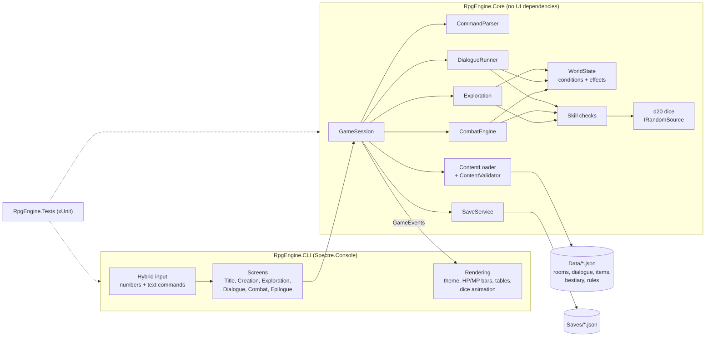

# text-rpg-engine

A narrative-driven, text-based RPG engine for the terminal, written in C# on .NET 10. It draws on tabletop d20 rules (the 5e SRD), the exploration of **Zork**, and the turn-based dungeon combat of **Wizardry** and **The Bard's Tale**.

The engine is **purely data-driven**. Every room, item, monster, line of dialogue, class, and rule constant is loaded from JSON in [`Data/`](Data/), so new adventures can be written without touching C#.

> **Status:** Phase 1 (scaffold, tooling, docs) is done. **Milestone 1, the vertical slice, is in progress.** The features below describe that milestone's target.

---

## Features (Milestone 1 target)

- **Exploration:** rooms connected by exits (north, up, in…), with rich sensory descriptions, inspectable features, hidden secrets, and puzzles.
- **Choices & consequences:** branching dialogue and event trees that read and write a global `WorldState` (flags, counters, faction reputation, quest stages). Choices permanently change the world.
- **d20 mechanics:** STR/DEX/CON/INT/WIS/CHA, classes, proficiency and expertise, and inventory and equipment. Narrative skill checks show inline, e.g. `[Persuasion DC 14]`, with advantage and disadvantage.
- **Tactical combat:** initiative, attacks against AC, crits, spells and techniques, status effects, resistances, and **Flee** and **Parley** options.
- **Retro terminal UI** ([Spectre.Console](https://spectreconsole.net/)):
  - color-coded narration, HP/MP bars, stat tables, and animated dice rolls
  - **hybrid input**: pick numbered options or type classic commands like `look`, `inspect altar`, `press sun`
- **Save/Load** to JSON in `Saves/`.

## Architecture



**Key principles:**
- **Core never touches the console.** It returns `GameEvent`s, and the CLI decides how to show them.
- **All randomness goes through an injectable `IRandomSource`.** That makes every roll reproducible with `--seed` and exactly testable.
- **Content is validated at startup.** Broken references, typos, and bad dice expressions are all reported at once, and the same validation runs in the test suite.

## Project structure

```
RpgEngine.slnx
Data/                   Game content (JSON): Rules/, World/, Rooms/, Dialogues/, Items/, Bestiary/, game.json
src/RpgEngine.Core/     Engine: dice, characters, checks, world state, content, combat, persistence
src/RpgEngine.CLI/      Terminal UI and game loop
tests/RpgEngine.Tests/  Unit, content-validation, and playthrough tests
CLAUDE.md               Contributor guide: coding standards, JSON schemas, Git workflow
```

## Getting started

**Prerequisites:** the [.NET 10 SDK](https://dotnet.microsoft.com/download/dotnet/10.0); `global.json` pins 10.0.401 or a later feature band. A modern terminal (Windows Terminal, iTerm2, any recent Linux terminal) gives the best colors and Unicode bars.

```bash
git clone https://github.com/phanto17/text-rpg-engine.git
cd text-rpg-engine
dotnet build
dotnet test
dotnet run --project src/RpgEngine.CLI
```

Useful flags (after `--`): `--seed <n>` for a reproducible run, `--no-anim` to skip dice animations, `--data <dir>` for an alternate content folder, `--saves <dir>` for an alternate save folder.

## How to play (Milestone 1)

At each prompt, type the **number** of a listed action or a **command**:

| Command | Meaning |
|---|---|
| `look`, `l` | Describe the room again |
| `go north`, `n` `s` `e` `w` `u` `d` | Move |
| `inspect <thing>`, `x <thing>` | Examine a feature, item, or person |
| `<verb> <thing>` | Interact, e.g. `read inscription`, `press sun` |
| `take <item>` / `drop <item>` | Pick up or drop |
| `use <item> [on <thing>]`, `equip <item>` | Use or equip items |
| `talk to <npc>` | Start a conversation |
| `inventory`, `i` · `stats`, `c` · `journal`, `j` | Character info |
| `save [slot]` / `load [slot]` | Save or load (exploration only) |
| `help`, `?` · `quit` | Help or quit |

## Writing content

Everything lives in `Data/`. To add a room, an item, or a whole dialogue tree:

1. Add JSON following the schemas in [CLAUDE.md](CLAUDE.md#content-json-reference).
2. Run `dotnet test`. Content validation reports every broken reference or typo.
3. Play it with `dotnet run --project src/RpgEngine.CLI -- --seed 1`.

## Testing

```bash
dotnet test
dotnet test --collect:"XPlat Code Coverage"
```

Tests are deterministic. They use scripted dice (`FixedRandomSource`) for exact outcomes and a fixed-seed PRNG for statistical checks of dice fairness.

## Roadmap

- [x] **Phase 1:** solution scaffold, tooling, documentation, Git and GitHub
- [ ] **Milestone 1 (vertical slice):**
  - character creation
  - a 3-room starter dungeon, *Barrowlight*: an NPC dialogue with skill checks and a permanent consequence, an inspectable puzzle, and a turn-based combat encounter with flee and parley
  - save and load
  - full test coverage of dice and skill checks
- [ ] **Later:** leveling and rests, multi-character parties, races and backgrounds, shops, more dungeons, JSON Schema export for editor autocomplete, CI

## Contributing

See [CLAUDE.md](CLAUDE.md) for architecture rules, coding standards, the full JSON schema reference, and the Git workflow (Conventional Commits; commit only when the build and tests are green).
